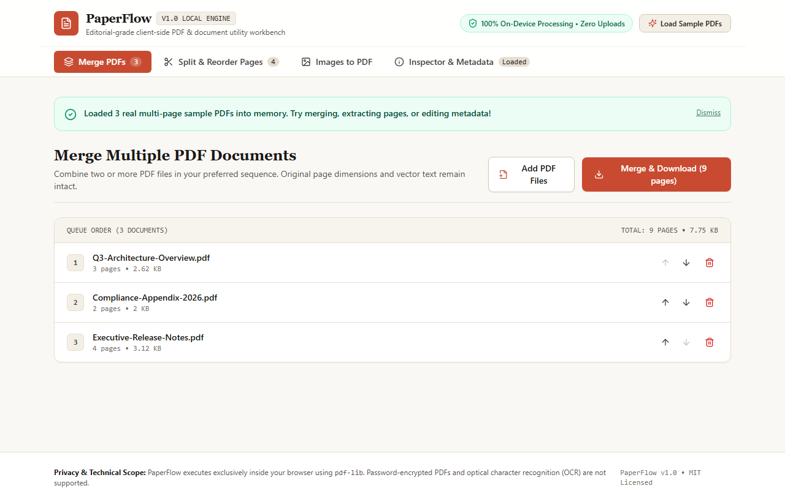
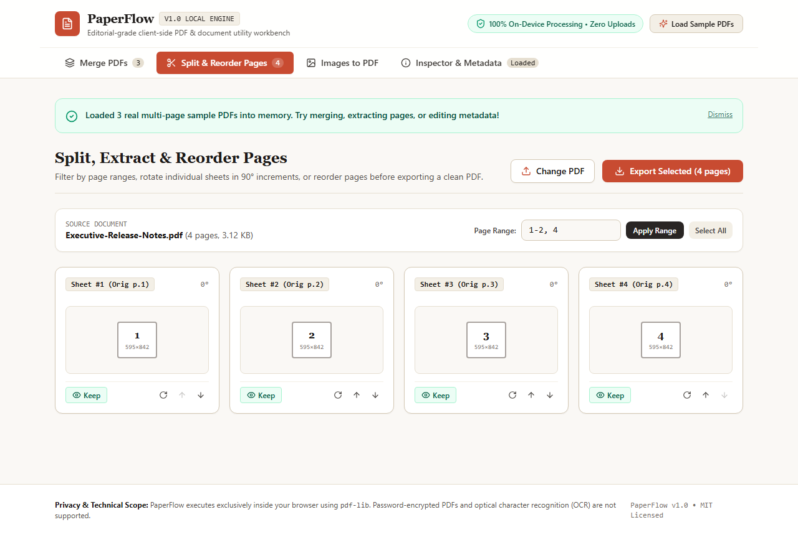
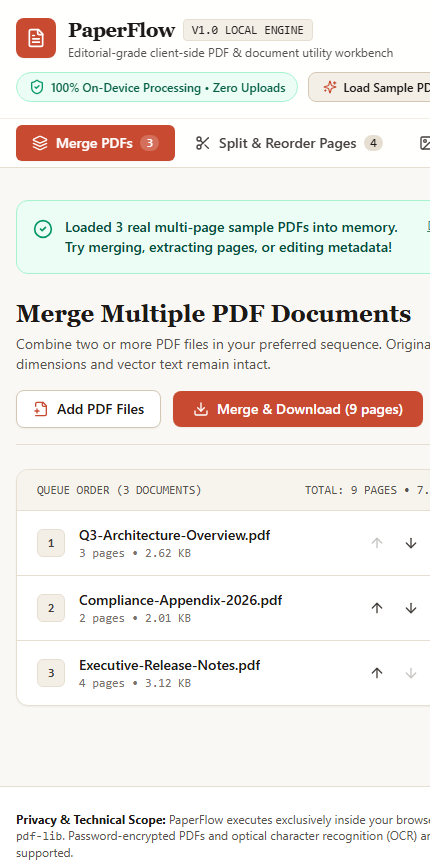

# PaperFlow — Private Browser-Side PDF & Document Workbench

[](https://opensource.org/licenses/MIT)
[](https://www.typescriptlang.org/)
[](https://react.dev/)
[](https://github.com/iamnarace/paperflow/actions/workflows/ci.yml)

**PaperFlow** is a privacy-first, client-side PDF and document utility workbench that enables merging, splitting, page reordering, rotation, image-to-PDF compilation, and metadata sanitization directly inside your browser—with zero server uploads.

---

## Why PaperFlow?

Many everyday PDF tasks—combining signed pages, extracting an appendix, converting receipt photos into a clean PDF, or stripping hidden author metadata before sending a file—often force users to upload sensitive documents to third-party cloud converters.

**PaperFlow** solves this by executing every byte operation locally inside your browser memory using `pdf-lib` and the HTML5 File API. Your files never leave your device.

---

## Key Features

- **PDF Merge Queue:** Combine two or more PDF files in any custom sequence while preserving original page dimensions, fonts, and vector graphics.
- **Page Split, Extract & Reorder Studio:** Filter pages using range expressions (e.g., `1-3, 5`), toggle individual sheets on or off, rotate pages in 90° increments, and reorder pages before exporting.
- **Images to PDF Compiler:** Convert PNG and JPEG images into multi-page PDF documents with selectable page presets (`A4`, `US Letter`, or `Fit Exact Image Dimensions`), portrait/landscape orientation, and adjustable page margins.
- **Document Inspector & Metadata Sanitizer:** Audit exact file byte size, page counts, sheet geometry, creation/modification timestamps, keywords, and XMP stream presence, or strip document-level `/Info` dictionary fields and catalog/page `/Metadata` (XMP) and `/PieceInfo` entries.
- **Instant Sample Workspace:** Includes a built-in local sample PDF and slide generator so you can test merging, splitting, and metadata inspection with a single click.

---

## Screenshots

### Desktop — Merge PDFs Queue & Sample Workspace


### Feature View — Page Split, Extract & Reorder Studio


### Mobile Responsive Layout
<p align="left">
  
</p>

---

## Technology Stack

- **Frontend Framework:** React 18 + TypeScript 5
- **PDF Processing Engine:** [`pdf-lib`](https://pdf-lib.js.org/) (100% client-side JavaScript PDF manipulation)
- **Styling & Design System:** Tailwind CSS (Warm Alabaster Paper & Terracotta editorial theme)
- **Icons:** Lucide React
- **Build & Test Tooling:** Vite 6, Vitest 4, React Testing Library, ESLint

---

## Requirements & Installation

- **Node.js:** v20+ LTS recommended (v18.18+ supported for build/runtime)
- **npm:** v9+

```bash
# Clone the repository
git clone https://github.com/iamnarace/paperflow.git
cd paperflow

# Install dependencies
npm install
```

---

## Local Development, Build & Testing

```bash
# Start the local development server with hot reload
npm run dev

# Run ESLint static analysis
npm run lint

# Run automated unit and component tests (Vitest)
npm test

# Create a production build in ./dist
npm run build

# Preview the production build locally
npm run preview
```

---

## Usage Guide

1. **Quick Evaluation:** Click **Load Sample PDFs** in the top navigation bar to generate three multi-page sample PDFs directly in browser memory.
2. **Merging PDFs:** Open the **Merge PDFs** tab, drag and drop two or more `.pdf` files (or use the loaded samples), adjust the queue order using the up/down arrows, and click **Merge & Download**.
3. **Splitting & Reordering Pages:** Switch to **Split & Reorder Pages**, enter a page range such as `1-2, 4` and click **Apply Range**, or manually toggle **Keep/Skip**, rotate individual sheets by 90°, and click **Export Selected**.
4. **Converting Images to PDF:** Open **Images to PDF**, select PNG/JPEG files (or click **Load Sample Slides**), choose A4 / Letter / Fit sizing and margins, then click **Build PDF from Images**.
5. **Sanitizing Metadata:** Open **Inspector & Metadata** to inspect file properties or click **Strip All Metadata & Download** to clear hidden author/title headers.

---

## Project Structure

```text
paperflow/
├── .github/
│   ├── ISSUE_TEMPLATE/
│   ├── workflows/ci.yml       # Automated lint, test, and build CI pipeline
│   └── pull_request_template.md
├── docs/
│   └── screenshots/           # Genuine application screenshots
├── src/
│   ├── test/
│   │   ├── pdfEngine.test.tsx # Unit & UI integration tests
│   │   └── setup.ts
│   ├── utils/
│   │   └── pdfEngine.ts       # Pure client-side PDF manipulation functions
│   ├── App.tsx                # Main PaperFlow workbench interface
│   ├── index.css              # Editorial theme styles
│   └── main.tsx               # Application entry point
├── CHANGELOG.md
├── CONTRIBUTING.md
├── LICENSE
├── SECURITY.md
├── package.json
└── vite.config.ts
```

---

## Security & Privacy Considerations

- **No Network Transmission:** All document parsing and generation happen inside browser memory (`Uint8Array`). No files are uploaded to any backend server.
- **Metadata Stripping Scope & Limitations:** Clicking **Strip All Metadata & Download** removes the PDF Document Information Dictionary (`/Info` fields: `Title`, `Author`, `Subject`, `Keywords`, `Creator`, `Producer`, `CreationDate`, `ModDate`, and custom `/Info` keys) as well as document-level, page-level, and component-level `/Metadata` (XMP XML packet) and `/PieceInfo` streams while preserving valid PDF structure. It does **not** redact visible or hidden text inside page content streams, embedded font names, interactive form field values, annotations, or EXIF bytes inside embedded raster images.

---

## Known Limitations

- **Password-Encrypted PDFs:** Encrypted or password-protected PDF files cannot be modified without prior decryption.
- **No OCR or Full-Text Editing:** PaperFlow operates on PDF page structures, metadata headers, and embedded images. It does not perform Optical Character Recognition (OCR) on scanned text or reflow paragraph text inside existing PDF pages.
- **Browser Memory Bound:** Because files are processed in browser RAM, combining very large documents (e.g., >250 MB total) depends on available device memory.

---

## Roadmap

- [ ] Optional Web Worker offloading for multi-hundred-page PDF merges
- [ ] Page number watermark / Bates stamping overlay utility
- [ ] Drag-and-drop grid reordering with pointer gestures
- [ ] Optional PDF/A metadata compliance check

---

## Contributing

Contributions, bug reports, and feature enhancements are welcome! Please review [CONTRIBUTING.md](./CONTRIBUTING.md) before opening a pull request.

---

## Acknowledgements

Developed with assistance from Google Antigravity. Built with [`pdf-lib`](https://github.com/Hopding/pdf-lib), React, and Tailwind CSS.

---

## License

Licensed under the [MIT License](./LICENSE). Copyright (c) 2026 Naresh Adhikari.
